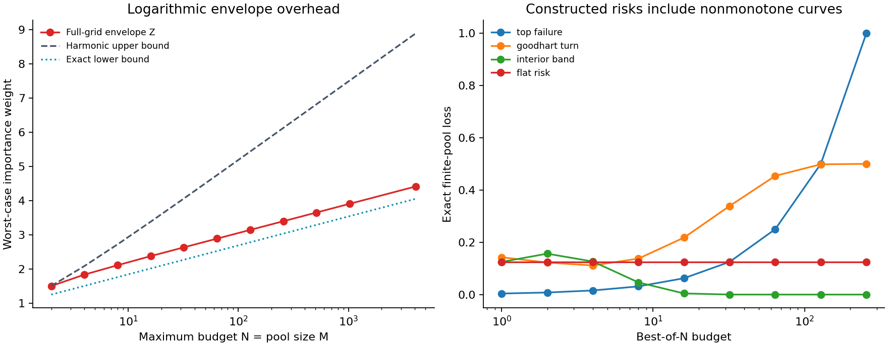
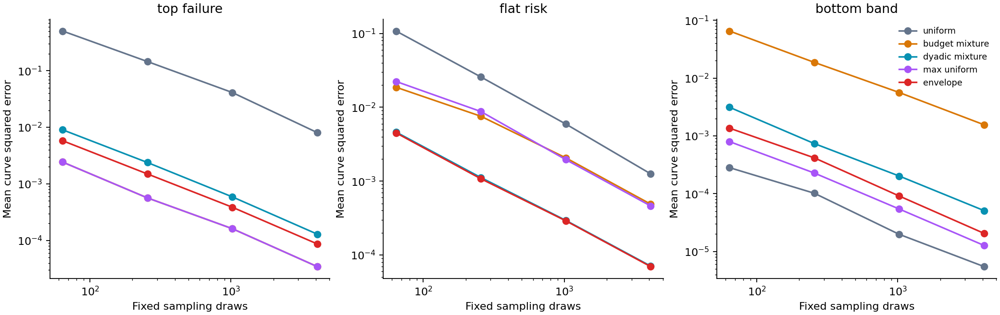

# Rank Envelope Audits

**Which outputs should receive scarce safety labels when auditing many best-of-N selection budgets?**

This research prototype studies that question for a fixed collection of scored candidate pools. It combines a mathematical analysis, a dependency-free audit tool, and reproducible synthetic experiments. The proposed audit distribution places more probability on ranks that matter to at least one target budget.

**Status:** version 0.14.1 research prototype; mathematical analysis and synthetic evidence. The specific mathematical contributions are candidates for external review, not established novelty claims. No real LLM evaluation or deployment safety guarantee is included.

**Working-draft follow-up:** [Repeated screening can reduce finite audit cost](docs/repeated-screening-theorem.md) studies a separate ideal noisy-rating/exact-adjudication model. Two finite examples give conditional cost gaps of at least 7.0% and 23.3% against every one-report-per-item hybrid policy under the same audit requirements. [Report, runnable example and reproduction](docs/repeated-screening-report.md) · [Self-review and unresolved questions](docs/repeated-screening-review.md). This Codex-derived draft has no independent proof review, established novelty, or real-model evidence; it does not change the released manuscript.

Here “one report” means one primitive cost-one rating. The [bundling analysis](docs/repeated-screening-bundling.md) derives a binary-report representation of the repeated gate and a conservative fixed price, clarifying its connection to existing cost-aware testing.

The [operational scope check](docs/repeated-screening-operational-check.md) finds that ordinary test-suite access provides stronger raw observations and motivates a different program-failure target. The noisy-oracle result currently has no demonstrated practical advantage for that setting.

**Current manuscript:** [Finite label costs for certifying best-of-N risk (PDF)](paper/finite-cost/manuscript.pdf) · [searchable source](paper/finite-cost/manuscript.md) · [proof/source map](paper/finite-cost/source-map.md) · [build and integrity](paper/finite-cost/README.md) · [review guide](docs/review-guide.md). The paper consolidates the all-grid finite-cost theorem, cached likelihood upper bound, matching dyadic rate, and their complete project-specific proof dependencies. It also states the limits of the original finite example. This release adds no scientific measurement or new theorem. Substantial Codex assistance is disclosed; Larry has not yet personally checked the research, and no independent human review or field impact is established. The [weighted-query follow-up](docs/weighted-query-followup.md) strengthens attribution of heavy-item sampling and deterministic tail truncation while leaving the final journal-paper comparison open.

[Research report](docs/report.md) · [Sharp finite-pool result](docs/sharp-envelope.md) · [Proofs](docs/theory.md) · [Related work](docs/related-work.md) · [Annotation example](examples/README.md) · [Research roadmap](docs/research-roadmap.md)

**A modest finite cost improvement.** The [checkpoint audit](docs/finite-checkpoint-report.md) lowers the original seven-budget expected-label upper bound from 1934.2 to `383040/199`, approximately **1924.824**. It buys every queried label and has a complete [real-loss proof](docs/finite-checkpoint-theorem.md), an exact rational callback reference, and a reproduced 2,439-bin certificate. The bound explicitly uses blind certification with probability `9/199`; the default callback disables that branch and has a separate 2016-label bound at error `1/200`. The improvement is about 9.376 labels, not a large practical saving or measured model result. Run `python -B -S -m experiments.check_finite_checkpoint --out artifacts/local/finite-checkpoint-reproduction.json` at a fresh path.

**Coverage between audited budgets.** The [coverage analysis](docs/grid-coverage-report.md) turns established normalized-risk convexity into an exact endpoint transfer rule. A dyadic-grid risk bound can grow by a sharp factor of `9/8` between endpoints; explicit fractional and binary tables exceed 0.1 despite risk at most `3/32` at all seven original budgets. Ten specified endpoints suffice to transfer level `3/32` to 0.1 across all 64 budgets. This is an attributed deterministic implication, with exact helper functions and counterexamples. It does not improve label cost or make a supplied margin into statistical evidence. Reproduce with `python -B -S -m experiments.check_grid_coverage --out artifacts/local/grid-coverage-reproduction.json`, using a new output path.

**Executable cached auditor.** The [callback reference](docs/cached-reference-report.md) implements the v0.13 likelihood construction with exact integer sampling, conservative likelihood updates, a finite proposal cap, and a fully charged prefix/census fallback. It buys each label once and certifies only the entire declared family. Its [numerical proof](docs/cached-reference-numerics.md) retains a uniform expected-label guarantee, including `17F + eta` under the stated separated-grid conditions. The program supports bounded rational inputs; the ideal proof has the broader real-label scope. This is implementation support for the existing theorem. It does not improve the original-instance 1,934.2 benchmark or establish model savings.

**Finite cost for every declared grid.** The [v0.13 candidate theorem](docs/all-grid-minimax-theorem.md) gives `F/2^38 <= C*(epsilon) <= 2^16 F` for every finite nonempty best-of-N grid, where `F=min(P*k_epsilon, sum_r min(P,H*e_r))`, `H=tau*log(1/delta)/epsilon^2`, and `k_epsilon` is the first prefix leaving at most epsilon mass under the smallest budget. It requires `tau<=1/8`, `epsilon<=tau/16`, and `delta<=1/4`, with one globally valid auditor and worst expected distinct-label cost over the supplied-margin class. It removes the earlier density, replication, and minimum-budget restrictions. The [cached likelihood construction](docs/cached-likelihood-audit.md) improves the upper constant to 17 on factor-two-separated grids. The [report](docs/all-grid-minimax-report.md) explains the formula, a dyadic sublinear-cost corollary, and 27,600 exact finite configurations. Constants remain loose; the stronger original-instance certificate below is preserved. [Established ingredients and unresolved priority](docs/all-grid-minimax-priority.md).

**Stronger bounds for the original decision.** The [monotone-placement theorem](docs/monotone-placement-theorem.md) gives `1100 < C*(1/160) <= 1934.2` for 32 prompts, 64 candidates, all seven original budgets, threshold `1/10`, and error probability `1/20`. Here cost is the worst expected distinct-label count over tables whose risks are all at most `3/32`. The reusable result identifies the strongest placement within a specified class of common-safe fixed-count priors. Its [report](docs/monotone-placement-report.md) records the exact frontier comparison and separates the relaxed lower-bound calculation from an actual auditor. The upper bound uses a disclosed blind-certification mixture, not a statistical acquisition improvement. Zero-error auditing separately has minimax worst expected cost between 2,034 and 2,036 labels, with exact deterministic cost 2,036. [Established ingredients and scope](docs/monotone-placement-priority.md) · [Preserved v0.11 certificate](docs/finite-decision-report.md).

**Finite saturation for high budgets.** The [v0.10 candidate theorem](docs/finite-saturation-theorem.md) gives a matching cost formula, up to loose universal constants, when every declared budget is at least `m/4`. It covers every finite prompt count without a density condition. The formula combines a clipped-weight sampling cost with a deterministic prefix cap; the latter remains necessary as confidence increases. The [report](docs/finite-saturation-report.md) explains the exact scope, fixed arithmetic checks, and why a 512-label example covers only budgets 16, 32, and 64 rather than the original seven-budget decision. The [source comparison](docs/finite-saturation-priority.md) credits the classical sampling architecture and identifies unresolved priority. This is a theorem, not a new operational audit engine or measured efficiency improvement.

**Nonzero-table minimax extension for general grids.** The [v0.9 theorem](docs/finite-density-theorem.md) allows positive observations and compares one globally valid auditor across all fixed tables with every risk at most `tau-epsilon`. For a supplied margin epsilon, its worst-case expected distinct-label cost has order `Z_K*tau*log(1/delta)/epsilon^2` when the maximum item weight `max(K)/(P*m)` is at most `epsilon^2/[4*tau*log(4/delta)]`, with `tau<=1/8`, `epsilon<=tau/16`, and `delta<=1/4`. This replaces the [v0.8 proof's](docs/nonzero-minimax-theorem.md) many-prompts condition and can hold with a single sufficiently large pool. A deterministic prefix bound also shows why archive size or positive support size alone cannot supply a general lower formula. Its [report](docs/finite-density-report.md) and [source comparison](docs/finite-density-priority.md) remain preserved. Neither nonzero result gives separately selectable confidence bands.

**Sharp zero-table cost.** For any nonempty declared best-of-N budget grid K, classical multi-target NEGEXP attains the optimal leading expected distinct-label cost among all valid adaptive audits that almost surely certify the zero table: `OPT_0 ~ C_NEG ~ log(1/delta)*Z_K/tau`. This holds jointly as `tau -> 0` and `log(1/delta)*max(K)/(P*m*tau) -> 0`, with `0 < delta <= 1/4`. The [structural proof](docs/sharp-grid-structure.md) and [report](docs/sharp-grid-report.md) explain why the limit survives arbitrary gaps, including omission of budget 1, and why it fails for general decreasing target rows. Sparse grids use their actual Z_K; the log(N)/e simplification is specific to the full prefix. The [earlier full-prefix proof](docs/sharp-cost-theorem.md) and [certificates](docs/sharp-cost-report.md) remain preserved.

**Practical boundary.** The preceding sharp zero-table result is asymptotic. In an already published synthetic scenario, all declared risks are below 0.1, yet ideal zero-only NEGEXP certifies with probability only about 0.47%. The [analytical example](docs/sharp-grid-report.md#what-decision-this-can-inform) shows why this result does not establish useful power on general safe tables. The [inspection-priority review](docs/inspection-priority-review.md) records substantial older foundations and an unresolved proof-level comparison.

**Finite-table cost guarantees.** When every candidate's loss is zero, classical multi-target NEGEXP uses at most **320 times** the optimal expected number of distinct labels among all valid adaptive audits in the stated class, for any declared budget grid containing **1**. The bound improves to **160** when every power of four through the maximum is declared. Both require equal fixed pools, a predeclared whole-family decision, risk threshold at most 1/8, and error probability at most 1/4. They include finite census effects. [Arbitrary-grid proof](docs/sparse-grid-theorem.md) · [Original sharper bound](docs/zero-cost-theorem.md).

The arbitrary-grid result audits exactly the requested targets. A counterexample shows why dropping every grid restriction fails uniformly as confidence increases, even at a fixed threshold. The [extension report](docs/sparse-grid-report.md) explains the new argument, boundary, and 122,900 exact finite checks. These are scope improvements to a candidate theorem, not a new generic auditing algorithm.

The factor is deliberately loose. For the existing geometry of 32 pools of 64 candidates, seven dyadic budgets, threshold 0.1, and error probability 0.05, exact rational certificates bound the design's expected zero-table cost within **1.398 times** the adaptive optimum. These are analytical bounds, not measured model performance. They concern a different decision and design from the published six-bet confidence-sequence engine. [Cost certificates and reproduction](docs/zero-cost-report.md).

**Standalone zero-table manuscript, frozen at v0.7:** [sharp-cost PDF](paper/sharp-cost/manuscript.pdf) · [Markdown source](paper/sharp-cost/manuscript.md) · [build and integrity instructions](paper/sharp-cost/README.md) · [review guide](docs/review-guide.md). It presents the arbitrary-grid zero-table theorem and monotone-family counterexample with complete proofs, the analytical power limitation, and unresolved priority. It consolidates v0.7 evidence and does not include the later nonzero extension.

**Earlier research note:** [seven-page PDF](paper/paper.pdf) · [Markdown source](paper/paper.md). It consolidates the frozen v0.3 finite-pool evidence. Both manuscripts disclose substantial AI assistance; the earlier scientific sources and results are preserved.

**Use the cost theorem:** the [zero-only annotation workflow](docs/zero-workflow.md) creates a randomized query plan, commits its immutable content before annotation, and verifies a whole-family certificate when every selected loss is exactly zero. Its rational arithmetic and integer rejection sampler preserve the applicable factor-160 or factor-320 guarantee under the stated assumptions. The [numerical proof](docs/zero-workflow-numerics.md) explains the implementation; hand-authored arithmetic fixtures exercise its outcomes without claiming model evidence. Run `python -S -m goodhart_audit.zero --help` with no installation.

**Earlier finite-pool theory and stronger baselines.** The [v0.3 follow-up](docs/design-report.md) adds attributed variance-optimal and fixed-width proposals, correcting the initial comparison's omission. In the rare-top scenario, the variance proposal certifies the largest budget after median 129 unique labels versus 163 for the envelope. Other proposals are faster for that single target; whole-family comparisons also have counterexamples.

The anytime implementation queries each candidate at most once and supports stopping after any labeled prefix. The [workflow](docs/anytime-report.md) and [attributed proof](docs/anytime-theory.md) describe its established weighted-without-replacement foundation. The combined comparison has 5,600 method paths from 800 independent scenario–replicate streams, including 4,000 previously published paths. It is a synthetic follow-up on known scenarios, not a fresh holdout.



## The result

Let a pool have $m$ candidates, rank $r=1$ be best, and the policy select the best of a uniformly random subset of $n$ candidates. The established winner-rank law is

$$w_n(r)=\frac{\binom{m-r}{n-1}}{\binom{m}{n}}.$$

For every budget $n=1,\ldots,N\le m$, audit ranks using the classical normalized envelope

$$q^*(r)=\frac{\max_{n\le N}w_n(r)}{Z_{m,N}},\qquad Z_{m,N}=\sum_r\max_{n\le N}w_n(r).$$

The finite without-replacement analysis establishes

$$Z_{m,N}=1+\sum_{n=2}^{N}\operatorname{TV}(w_n,w_{n-1}),$$

$$0\le Z_{m,N}-L_N\le\frac{N-L_N}{m+1}<1.$$

Here $L_N=1+\sum_{n=2}^{N}(n-1)^{n-1}/n^n$ is the established continuous-rank normalizer. Thus $Z_{m,N}=(\log N)/e+O(1)$ uniformly over $m\ge N$, including $m=N$. The [new proof](docs/sharp-envelope.md) also gives the second-order correction as $N/m$ varies.

This bounds the optimal **largest importance weight**, compared with $N$ for uniform-rank auditing. It is not a minimax label-complexity theorem or universal variance claim. The continuous normalizer and score-based envelope audits already appear in [Fitas (2026, v2)](https://arxiv.org/html/2608.21496v2); the general minimax identity is classical NML theory. The initial abstract-only literature comparison missed that overlap and has been corrected. The proposed mathematical distinction is the finite-pool remainder and joint-limit profile, with novelty still subject to external review.

## What the experiments show

Eight synthetic fixed-pool scenarios, five acquisition methods, four draw counts, and 200 repetitions produce **32,000 audit evaluations**. Methods and draw counts share random numbers: there are 1,600 independent scenario–replicate streams, not 32,000 independent experiments.

For 256 candidates and nine target budgets, the maximum importance weight is **3.362** for the envelope, **9** for a dyadic mixture, and **256** for uniform sampling. The full 256-budget envelope constant is **3.395**, a different quantity.

At 256 draws, mean squared error averaged over the nine risk budgets was:

| Constructed loss pattern | Uniform | Dyadic mixture | Envelope |
| --- | ---: | ---: | ---: |
| Top-ranked candidate always fails | 0.145185 | 0.002385 | 0.001497 |
| Same failure prevalence at every rank | 0.025739 | 0.001118 | 0.001077 |
| Bottom quarter of ranks fail | **0.000102** | 0.000736 | 0.000417 |

The envelope wins some comparisons and loses others. A proposal concentrated on the top rank beats it on the top-only scenario. Comparisons use equal **fixed draws**, with unique-label costs reported separately; they do not establish superiority at equal unique annotation budgets.

The valid bands covered all nine true risks in 200/200 repetitions in each setting, and were conservative. This is not evidence of exact 95% calibration. For one setting, 200/200 has a 95% Wilson interval of approximately [0.981, 1]. Full metrics, Monte Carlo uncertainty, negative results, and assumptions are in the [report](docs/report.md).



## Run without installation

Python 3.10+ is sufficient for the core, CLI, and result-integrity check. The synthetic runner additionally uses NumPy and Matplotlib if already installed. Nothing downloads models, datasets, packages, or other artifacts.

Verify the v0.1-v0.3 saved evidence with the standard library, or rerun those numerical studies with already-installed NumPy and SciPy:

```console
python -m experiments.reproduce --verify-only
python -m experiments.reproduce --out artifacts/local/full-reproduction
```

Verification checks saved artifacts and source integrity; it does not recompute results or prove theorems. Full mode requires a new output directory, runs the tests, regenerates all three numerical studies and the exact theorem checker, and compares ten numerical artifacts byte for byte. It preserves published results and writes a diagnostic report. Figures and manifest bytes are excluded from regeneration/comparison; software-version differences may produce a reported mismatch. The [paper build](paper/README.md) is separate.

The v0.4 cost theorem has a separate standard-library check and exact rational cost certificates. Its command and scope are documented in the [cost report](docs/zero-cost-report.md). The older reproduction command retains its ten-artifact comparison; it does not silently include this new follow-up.

The v0.5 arbitrary-grid extension also has a separate exact checker: `python -B -S -m experiments.check_sparse_grid --out artifacts/local/sparse-grid-reproduction.json`. Use a new output path. Its source pins, finite scope, and saved artifact are documented in the [extension report](docs/sparse-grid-report.md).

The v0.6 sharp-cost theorem uses `python -B -S -m experiments.check_sharp_cost --out artifacts/local/sharp-cost-reproduction.json`, again with a new path. It checks exact hypergeometric bounds and conservative cost certificates on symbolic populations without allocating their candidate tables. The [report](docs/sharp-cost-report.md) distinguishes those arithmetic checks from the unbounded proof. The [nonzero-table note](docs/nonzero-cost-limits.md) records why two plausible extensions were set aside as established ideas.

The v0.7 structural extension uses `python -B -S -m experiments.check_sharp_grid --out artifacts/local/sharp-grid-reproduction.json`, with a new path. Its [report](docs/sharp-grid-report.md) documents exhaustive small-grid checks, analytical certificates, and the monotone-family counterexample. The existing annotation workflow keeps its earlier finite-factor domain and resource caps.

The v0.9 finite-density extension uses `python -B -S -m experiments.check_finite_density --out artifacts/local/finite-density-reproduction.json`, with a new path. Its [report](docs/finite-density-report.md) documents the exact prefix identities, finite binary-table enumeration, symbolic density certificates, and saturation counterexamples. The [frozen v0.8 calculation](docs/nonzero-minimax-report.md) has its own unchanged command and source pins.

The v0.10 finite-saturation extension uses `python -B -S -m experiments.check_finite_saturation --out artifacts/local/finite-saturation-reproduction.json`, with a new path. The [report](docs/finite-saturation-report.md) separates finite-population reciprocal-count checks, high-budget envelope geometry, and symbolic confidence-cap examples from the complete mathematical proof.

The v0.11 finite-decision certificate uses `python -B -S -m experiments.check_finite_decision --out artifacts/local/finite-decision-reproduction.json`, with a new path. Its [report](docs/finite-decision-report.md) distinguishes the exact lower certificate for the original decision from the more informative two-prior test used to derive it.

The v0.12 placement reduction uses `python -B -S -m experiments.check_monotone_placement --out artifacts/local/monotone-placement-reproduction.json`, again with a new path. It evaluates 386 specified frontier certificates and one separate clean witness. The [report](docs/monotone-placement-report.md) explains the source freeze, exact arithmetic, scope of selection, and separate zero-error benchmarks.

The v0.13 all-grid characterization uses `python -B -S -m experiments.check_all_grid_minimax --out artifacts/local/all-grid-minimax-reproduction.json`, with a new path. Its [report](docs/all-grid-minimax-report.md) records the exact family, conditional-tail, finite-slice, mixture, and likelihood checks. The 13,025-byte result reproduces exactly; finite checks support the arithmetic rather than proving universal quantifiers.

The v0.13.1 callback demonstration uses `python -B -S -m experiments.run_cached_reference --out artifacts/local/cached-reference-reproduction.json`, with a fresh path. The [usage and evidence report](docs/cached-reference-report.md) separates illustrative seeded runs from the proof and exact small-process checks. Use the callback API to connect fixed correct labels; this release adds no external annotation service.

```console
python -m unittest discover -s tests -v
python -m experiments.verify_results
python -m experiments.verify_anytime_results
python -m experiments.verify_design_results
python -m goodhart_audit --help
```

The complete test suite includes reproduction tests that need installed NumPy and SciPy. To check the new zero-only modules with site-packages disabled, use `python -S -m unittest discover -s tests -p "test_zero*.py" -v`. To rerun the original full study with existing NumPy/Matplotlib:

```console
python -m experiments.run_study --out artifacts/local/reproduction
python -m experiments.verify_results --results artifacts/local/reproduction
```

Use `--no-plots` if only NumPy is available. Use a fresh output directory for each configuration. The manifest lists only files generated in that run, hashes the relevant source files and output bytes, and records the protocol and environment. Floating-point or image-byte differences across software versions are possible.

The checked-in study contains 128 prompts × 256 binary labels per scenario. Its generated outputs occupy about 6 MB. This project was built with no dependency/model/dataset downloads and stayed far below its 2 GB storage limit.

The additional anytime study uses 32 prompts × 64 candidates per scenario. Reproduce it with:

    python -m experiments.run_anytime_study --out artifacts/local/anytime-reproduction
    python -m experiments.verify_anytime_results --results artifacts/local/anytime-reproduction

The optimized-proposal follow-up additionally needs existing SciPy. Its verifier and theorem check use only the standard library. Choose a new output directory for each run:

    python -m experiments.run_design_study --out artifacts/local/design-reproduction
    python -m experiments.verify_design_results --results artifacts/local/design-reproduction
    python -m experiments.check_sharp_envelope --out artifacts/local/sharp-envelope-reproduction.json

## Audit your own fixed pools

Provide JSONL with `prompt_id` and a `candidates` list containing `candidate_id`, `proxy`, and optional `text`. All pools must have the same size. Proxy scores determine descending order; equal scores use ascending candidate ID. See [the example and schema](examples/README.md).

```console
python -m goodhart_audit plan --pool examples/pools.jsonl --out artifacts/local/audit.json --draws 32 --seed 7 --budgets 1,2,4
```

Fill only `queries[].loss` with independently assigned values in [0,1], then:

```console
python -m goodhart_audit report --pool examples/pools.jsonl --audit artifacts/local/audit.json --out artifacts/local/report.json --delta 0.05 --threshold 0.1
```

Each report contains an unbiased importance estimate, simultaneous empirical Bernstein bounds, sharp missing-label bounds, and individually certified budgets. Certification concerns **these exact pools and the declared loss definition**. It does not validate the labeler, cover new prompts, extend beyond the pool size, support optional stopping, or prove that every budget below the largest certified one is safe.

That restriction on stopping applies to the original commands above. The new plan-unique and report-unique commands use an explicitly anytime-valid design. [The follow-up guide](docs/anytime-report.md#use-the-workflow) explains contiguous-prefix labeling and the two available certification rules.

## Research integrity

The protocol was committed before the experiment; it was not externally preregistered. Independent agent reviews checked the mathematical argument and implementation; these are not human peer review. The initial release was developed with substantial Codex assistance. [Provenance and contribution disclosure](docs/provenance.md) distinguishes recorded work from validation still needed.

Corrections, counterexamples, overlooked prior art, and independent reproductions are welcome. See [CONTRIBUTING.md](CONTRIBUTING.md). Code and project-authored text are MIT licensed; cited works retain their own licenses.
