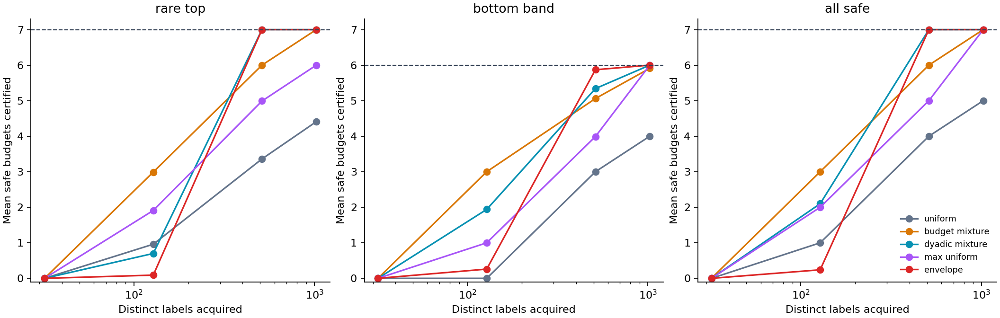

# Anytime auditing at equal unique-label cost

**Follow-up study, 26 October 2026. Synthetic evidence only.**

The initial release compared sampling proposals at fixed numbers of draws. Duplicate draws reused cached labels, and its confidence bounds did not support stopping when a desired number of unique labels had been acquired. This extension addresses that limitation: every query requests a distinct candidate, and a report can be inspected after any labeled prefix, including one chosen by a data-dependent stopping rule.

The statistical foundation is established work, particularly [Shekhar et al., Risk-limiting Financial Audits via Weighted Sampling without Replacement (UAI 2023)](https://proceedings.mlr.press/v216/shekhar23a.html). Our extension specializes that construction to several best-of-N risk targets, uses the rank envelope to choose candidates, and supplies an auditable query plan and reporting implementation. We do not claim a new general confidence-sequence theorem. [Related work](anytime-related-work.md) gives the correspondence; [the mathematical note](anytime-theory.md) states the assumptions and derivation.

## What changes

For each candidate i and budget n, let a[n,i] be its known target probability mass. After observing some labels, sample an unseen candidate proportionally to its frozen proposal h[i]. Previously observed weighted losses and remaining proposal masses determine a predictable, target-specific scale. Fractional-betting test martingales are inverted into simultaneous confidence sequences.

The guarantee covers every declared budget and every prefix length of the same audit with probability at least 1−delta. It allows stopping after a unique-label quota or once sufficient evidence has accumulated. All probability remains conditional on the frozen candidate pools and fixed correct loss labels. It does not cover new prompts, a changed scorer, or errors in the label definition.

For the envelope, h[i] is proportional to max_n a[n,i]. After any acquisition history, renormalizing this envelope over unseen candidates still minimizes the largest importance ratio across the remaining target family. This is an application of the established envelope principle. It concerns a bound on observation size, not universal annotation-cost optimality.

## Prespecified comparison

[anytime_protocol.json](../experiments/anytime_protocol.json) was committed as 2095a91 before measurements. It is an internal prespecification, not an external preregistration.

The eight constructed loss patterns contain 32 prompts × 64 ranks: 2,048 distinct candidates per scenario. Targets are budgets 1, 2, 4, 8, 16, 32, and 64. Each method acquires up to 1,024 distinct labels. We record results at 32, 128, 512, and 1,024 labels, while checking statistical error events at every intervening draw.

There are 100 repetitions per scenario, five acquisition methods, and the same six-fraction betting mixture for every method. All methods use target-specific predictable scales and deterministic missing-label bounds. Acquisition is a weighted exponential race independent of labels. Shared race uniforms pair methods within a scenario/repetition. Thus 4,000 method paths and 16,000 checkpoint records arise from 800 independent scenario–replicate streams.

The outcomes are ever missing a true target risk, ever falsely certifying a target at threshold 0.1, certified-target counts at equal unique-label checkpoints, and the first label count at which the full-pool budget is certified. Uncertified runs are censored. No model-generated outputs or real-world safety prevalence estimates enter this study.

The stopping criterion is specifically the **directional upper test**: either the deterministic upper bound is already below threshold, or the upper test wealth at the threshold crosses its boundary. This is the public engine's upper-certification rule and the CLI's explicit upper-test option. The CLI default additionally refuses certification if the two-sided interval is empty. Those rules can differ on a confidence-failure path; the study's costs must not be interpreted as measured costs of the more conservative default rule.

## Results and counterexamples

At 512 distinct labels, mean numbers of truly safe target budgets certified were:

| Pattern | Uniform | Budget mixture | Dyadic mixture | Max/uniform | Envelope |
| --- | ---: | ---: | ---: | ---: | ---: |
| Rare top failure | 3.36 | 6.00 | 7.00 | 4.99 | 7.00 |
| Bottom-band failures | 3.00 | 5.06 | 5.34 | 3.99 | 5.87 |
| Prompt-cluster failures | 0.38 | 4.26 | 2.44 | 1.34 | 1.39 |
| All safe | 4.00 | 6.00 | 7.00 | 5.00 | 7.00 |

The table reports selected contrasts, not an average over scenarios or a universal ranking. [All settings and Monte Carlo SEs](../results/anytime/summary.csv) are included. In the prompt-cluster scenario, the envelope loses to the dyadic and budget-mixture proposals at this checkpoint. At 128 labels, it also certifies fewer budgets than the dyadic mixture in the rare-top and all-safe cases. A small maximum-weight bound does not guarantee the earliest partial results.

For the largest target budget in the rare-top scenario, all nonuniform methods certify in all 100 runs by 512 labels. Median first certification times are:

| Proposal | Median distinct labels | Successes by 512 labels |
| --- | ---: | ---: |
| Uniform | Not reached | 0/100 |
| Budget mixture | 93 | 100/100 |
| Dyadic mixture | 200.5 | 100/100 |
| Max/uniform | 103.5 | 100/100 |
| Envelope | 163 | 100/100 |

The envelope uses about 19% fewer labels than the dyadic mixture for this stopping target, while top-focused proposals are faster. At 512 labels, the envelope and dyadic proposals certify all seven budgets in this scenario; the budget mixture certifies six. This is a tradeoff between evidence for one extreme budget and the whole family. The medians are descriptive simulation results; no significance or universal cost-improvement claim follows.

The largest observed ever-miscoverage rate among method/scenario settings through 1,024 labels is 2/100. No false certification is observed. These measurements do not prove exact 95% calibration: a 95% Wilson interval around 2/100 is roughly [0.0055, 0.0700], and around 0/100 is roughly [0, 0.0370]. Such intervals describe one setting, not simultaneous uncertainty across every setting. Validity rests on the martingale argument and assumptions; the empirical study checks an implementation and compares performance.

The betting mixture is fixed to six fractions, from 1 down to 1/32. It is not an optimized or asymptotically universal betting strategy. Its finite grid can limit sensitivity to small departures before census. All proposals share this limitation; improved betting is a separate comparison.

## Reproduction

From the repository root, with the existing numerical libraries:

    python -m unittest discover -s tests -v
    python -m experiments.run_anytime_study --out artifacts/local/anytime-reproduction
    python -m experiments.verify_anytime_results --results artifacts/local/anytime-reproduction

The core and CLI use only the standard library. NumPy runs the study, and Matplotlib creates its figure; the --no-plots option omits plotting. No downloads or model calls occur. The manifest records protocol, source and output hashes, environment, synthetic label-table hashes, and true risk curves. Source hashes are captured before measurement and checked again before the manifest is written.

The verifier reconstructs aggregates and checks censoring and cumulative-event invariants. Exhaustive small-pool tests check mean-one martingales and optional-stopping coverage. Separate tests compare the public scalar engine and vectorized simulation, including tiny residual masses, zero wealth, endpoint behavior, and the exact directional certification rule. Floating-point arithmetic remains an approximation to the real-arithmetic theorem; the software is not a machine-verified formal proof.

## Use the workflow

Plan a randomized order without revealing source labels:

    python -m goodhart_audit plan-unique --pool examples/pools.jsonl --out artifacts/local/unique-audit.json --labels 8 --seed 7 --budgets 1,2,4

Label candidates in queries order. Fill a contiguous prefix of queries[].loss with values in [0,1]; leave the rest null. Then run:

    python -m goodhart_audit report-unique --pool examples/pools.jsonl --audit artifacts/local/unique-audit.json --out artifacts/local/unique-report.json --threshold 0.1

This defaults to the two-sided interval check. Add --rule upper-test to reproduce the study's directional stopping criterion; the report labels the rule and still shows any interval conflict.

You may inspect reports after further labels or stop based on these reports. The random order, proposal, target grid, bets, confidence level, and label definition stay fixed. Out-of-order labels and altered plans are rejected. The example candidates are invented workflow fixtures, not safety evidence. Existing plan/report commands keep their original fixed-time, with-replacement semantics.

This closes the unique-label and stopping-rule gap in the initial release. It does not close the real-model, external-novelty-review, or independent-human-validation gaps.
