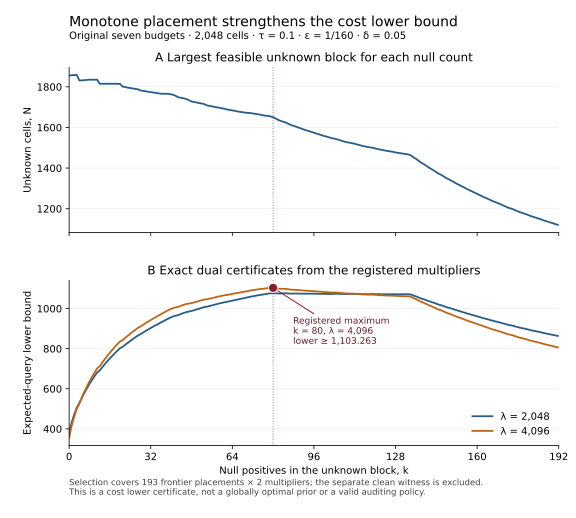

# Stronger finite cost bounds by placing hard priors

Research extension, 27 October 2026. The [placement theorem](monotone-placement-theorem.md) gives a reusable reduction for constructing common-safe hard examples, and a stronger lower bound for the original seven-budget audit. It keeps the original 32 prompts, 64 candidates per prompt, budgets `1,2,4,8,16,32,64`, threshold `1/10`, margin `1/160`, and false-certificate allowance `1/20`.

The exact frontier calculation and the disclosed upper benchmark give

$$
1103.263793259\ \le\ C^*_{1/20}(1/160)\ \le\ 1934.2.
$$

The upper/lower ratio is at most **1.753161857**, rounded upward. Census alone is within **1.856310352** of the optimal worst-case cost. These statements concern the original whole-family decision, not separately selectable simultaneous confidence bands.

One auditor must be valid on every unsafe fixed table with losses in `[0,1]` and certify every safe table almost surely, including boundary-safe tables. Its cost is the worst expected number of distinct labels over tables whose seven risks are all at most `3/32`. The result concerns that entire efficiency class; it does not say every safe table is difficult.

## Why placement matters

The preceding [finite-decision result](finite-decision-report.md) used 192 positives shuffled over 1,024 bottom-half cells, with the other cells zero. Its lower bound was 784.185148748, and even unrestricted multiplier tuning for that same prior pair could not exceed 809.042. A stronger hard example was needed.

The new construction fixes some bottom cells to one, leaves a middle region uncertain, and fixes the top cells to zero. Moving some positives into the fixed bottom region permits a larger uncertain region while keeping every null table safe for all seven targets. The alternative adds 13 uncertain positives: its total of 205 positives violates the uniform target, while the null total of 192 is at the supplied margin.

Two structural facts make the search finite and interpretable. First, for fixed category counts, the zero-prefix / uncertain-middle / one-suffix arrangement minimizes every target's worst null risk whenever all target weights share one decreasing order. An adjacent exchange proof establishes this simultaneous statement. Second, for fixed null count and count difference, a larger uncertain population gives a no-smaller relaxed testing value. The proof reveals a latent subset and its outside zeros for free, reducing the larger experiment to the smaller one.

Together, these facts identify the largest feasible uncertain population as the strongest placement for each count split and multiplier in this class. They do not optimize over arbitrary priors, total positive counts, or all multipliers. The [attribution note](monotone-placement-priority.md) distinguishes the reduction from classical top-k uncertainty, experiment comparison, and sequential-testing dynamic programming.

## Exact finite comparison

The [protocol](../experiments/monotone_placement_protocol.json), committed as `c54379c`, fixes all 193 splits of the 192 null positives and multipliers 2,048 and 4,096. Selection uses these 386 frontier calculations only. A separately evaluated example has 288 fixed zeros, 1,648 uncertain cells containing 80 null positives, and 112 fixed bottom positives. Its integer certificate `5W > 6524D` gives the transparent conservative conclusion `C* > 1100`.

Both registered multipliers attain their strongest frontier certificate at `k=80`. This frontier has 286 fixed-zero cells, 1,650 uncertain cells, and 112 fixed-one cells. Its preceding placement with 285 fixed zeros violates the budget-4 margin constraint; every one of its own seven worst null risks is at most `3/32`.

| Calculation | Multiplier | Lower certificate, rounded down |
|---|---:|---:|
| Best of 193 frontiers | 2,048 | 1,076.700543152 |
| Best of 193 frontiers; selected | 4,096 | 1,103.263793259 |
| Separate clean witness, excluded from selection | 4,096 | 1,101.822853569 |

For the selected frontier, put `D=C(1650,80)C(1650,93)` and let `W` be the integer backward-recursion value specified in the proof. The saved exact integer inequality is `10^9 W >= 1308063793259 D`. Subtracting the multiplier penalty `4096/20` gives the stated conservative decimal lower bound. The full rational values and rounding residuals are retained in the [artifact](../results/theory/monotone_placement.json).



The figure shows the entire specified comparison. Its horizontal axis changes the null count as well as the maximal feasible population; the population-monotonicity theorem only compares populations with the count held fixed. The selected maximum is within the 386 registered cases, not a global optimum over all priors or multipliers.

The sequential-testing policies receive the common outside labels for free and are told the two possible positive totals. Those are proof relaxations. Their expected costs are not operational upper bounds for the original auditor, which receives no free labels or two-count promise. Budget 1 supplies the unsafe alternatives; all seven original targets constrain null feasibility.

## Separate zero-error benchmarks

| Auditor class | Worst expected distinct-label cost |
|---|---:|
| Deterministic, zero error | Exactly 2,036 |
| Randomized, zero error | Between 2,034 and 2,036 |
| Randomized, error allowance `1/20` | At least 1,103.263793259 and at most 1,934.2 |

For the deterministic upper bound, query all except twelve last-rank cells and use worst-case loss one at those omitted positions. Every margin-class table then certifies. If this fails on another table, census the remaining cells, ensuring all-safe completeness. A matching deterministic adversary places the first 192 queried bottom-half positives before any bottom-half zeros.

For the randomized zero-error lower bound, take the constant fractional table with loss `3/32` everywhere. Leaving fifteen cells unseen permits an unsafe completion. A finite family of completions makes the argument simultaneous outside a null set of random tapes, forcing at least 2,034 queries almost surely. The fourteen-unseen arithmetic check concerns the uniform target only; it does not supply an auditor attaining 2,034 for the whole family. This argument does not give a lower bound at positive error allowance.

The 1,934.2 upper bound is a routine mathematical benchmark allowed by the stated objective: certify immediately with probability `1/20`, and otherwise run the 2,036-label zero-error construction. Its expected margin cost is `(19/20)*2036`. It spends the entire allowed error on blind certification and is not an evidence-based acquisition improvement or a new operational audit engine.

## Reproduction and interpretation

Reviewed source commit `fafd66a` preceded the saved calculation. All seven direct and transitive source pins matched their committed Git bytes before the run. Exploratory calculations preceded the protocol freeze; this is not external preregistration.

The 387 calculations visit 48,663,235 null-possible count states in total, with certain null certification, cost/error bounds, and the Lagrange identity checked at every state. State checksums, policy cost/error diagnostics, and exact integer rounding certificates are retained. Across the calculations, the largest tracked integer is 1,512 bits and the rolling integer-array bound is 1,758 slots. The implementation never enumerates full binary label tables.

The structural matrix checks 340,761 sorting inequalities for all category assignments on up to seven cells with weights in `{0,1,2}`. It includes 105,795 zero-unknown-positive and 105,795 all-unknown-positive endpoint checks; these counts overlap. Another 442 exact counting identities verify latent-subset marginals through population size twelve. Frontier feasibility and its immediate infeasible predecessor are checked for every count split, including partial ranks and the `k=0` boundary.

All 266 repository tests pass. The 12 focused tests also pass with site packages disabled, normally and under optimized Python. Independent agent review compared 880 cases with a direct-combination rational recurrence and checked 660 population comparisons. A separate full-size rational recurrence, using direct binomial coefficients and conditional probabilities without importing the production checker, matched the selected case's exact value, policy cost/error, and checksum over all 127,251 states. Another review recomputed all 193 frontiers directly from the binomial weights and reconciled every saved certificate's arithmetic. These are separate agent checks, not independent human replication.

The separate figure renderer uses floating point only for drawing, after checking the exact values and selected maximum; its SVG and ignored PNG preview reproduce byte for byte. A [separate figure manifest](../results/theory/monotone_placement_figure.json) pins the saved result, renderer, and SVG.

The saved result is 2,162,229 bytes with SHA-256 `f870ef27ab5ad09abdba8be483c150fd6c2830d3bf25f2c1e8a2098e66bb6f37`. A separate full run to a fresh path reproduced every byte. Earlier saved evidence and all source/artifact pins remain verified.

```console
python -B -S -m experiments.check_monotone_placement --out artifacts/local/monotone-placement-reproduction.json
python -B -S -m unittest tests.test_monotone_placement -q
```

Use a fresh output path. The checker uses standard-library exact integers and fractions, rejects source drift and existing outputs, and pins direct and transitive scientific sources. The finite checks support the implementation; the general sorting and population-comparison statements rest on the mathematical proof.

To redraw the figure with already-installed Matplotlib, choose fresh output paths:

```console
python -B -m experiments.plot_monotone_placement --result results/theory/monotone_placement.json --svg artifacts/local/monotone-placement-figure.svg --preview artifacts/local/monotone-placement-figure.png
```

The stronger finite obstruction and placement reduction are research progress. They do not establish scientific priority, the general all-grid rate, an algorithm attaining the lower bound, label reliability, real-model usefulness, or independent human verification. The [provenance record](provenance.md) discloses substantial Codex assistance. No downloads, model study, or external outreach were undertaken. Publication does not establish field impact or fellowship competitiveness.
