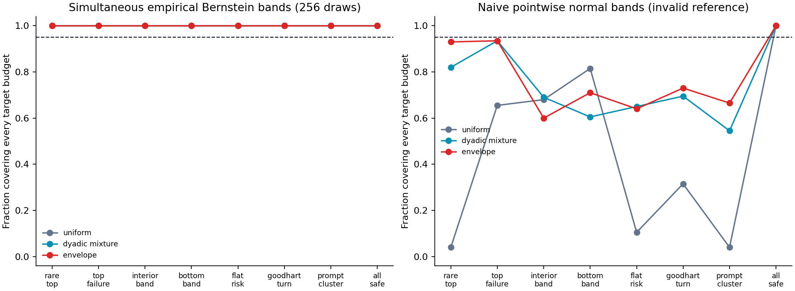

# Rank-envelope auditing: an offline research note

**Release 0.1 · 26 October 2026 · Synthetic fixed-pool evidence**

## Question and contribution

Best-of-N selection changes which outputs matter. A uniformly sampled candidate label may say little about failures concentrated among the highest-scored candidates. Auditing only the highest rank has the opposite problem: it cannot assess small selection budgets or failures elsewhere in the ranking. We investigate a single score-only sampling distribution for estimating an entire best-of-N risk curve from partially labeled, fixed candidate pools.

The method applies the classical normalized maximum-likelihood / sensitivity envelope to the winner-rank laws. Its proposed mathematical contribution is the specialization: an exact total-variation decomposition and matching logarithmic-order bounds on the envelope normalizer for every finite pool size $m\ge N$. The implementation combines ordinary importance sampling, simultaneous empirical Bernstein intervals, and deterministic missing-label bounds. The full proofs and assumptions are in [theory.md](theory.md); precise overlap with previous work is in [related-work.md](related-work.md).

This is a statistical audit contribution candidate. It does not introduce a new general importance-sampling principle, establish real-model reward hacking, or demonstrate deployment safety. A literature search did not identify the same finite-family theorem, but novelty remains provisional.

## Target and assumptions

Condition on P scored pools, each with m candidates. The target $R_n$ averages over prompts and over uniformly chosen size-n subsets within a pool, selecting the candidate with the highest proxy rank. Gold losses are fixed values in [0,1]. Audit randomness consists of independent uniform-prompt draws and rank draws from a proposal fixed before labeling. Repeated draws reuse a cached deterministic label but still enter the estimator as repeated draws.

No independence of the fixed candidate table is needed. Conversely, the confidence statements do not generalize to new prompts or candidates. They do not model noisy human labels, adaptive scorers, optional stopping, or a labeler systematically missing a failure category. Equal proxy scores use a declared deterministic candidate-ID order; random tie-breaking is a different policy.

The simultaneous band covers the declared budget grid at one predeclared draw count. It does not jointly cover every method, scenario, and horizon in the experiment. A selected budget is certified only if its own upper bound passes the threshold. Nonmonotone curves prevent interpreting this as certification of all smaller budgets.

## Mathematical result

For $w_n(r)=\binom{m-r}{n-1}/\binom m n$, define $s(r)=\max_{1\le n\le N}w_n(r)$, $Z=\sum_rs(r)$, and $q^*=s/Z$. Classical NML theory implies that q* minimizes the largest density ratio over the target family. The specialized result is

$$Z_{m,N}=1+\sum_{n=2}^N\mathrm{TV}(w_n,w_{n-1}),$$

$$1+\sum_{n=2}^N (n-1)^{n-1}/n^n\le Z_{m,N}\le H_N.$$

The first identity follows from unimodality in n at each fixed rank. Deleting one uniformly random member of an n-subset gives the harmonic upper bound. A common beta kernel maps finite rank laws into maximum-of-n uniform densities; contraction of total variation gives the lower bound. Together these prove Θ(log N) growth uniformly over m≥N. The claim is about the minimax largest importance weight, **not** minimax variance or label complexity among arbitrary audit strategies.

At m=N=4,096, the computed full-grid envelope constant is 4.4142, between the explicit lower bound 4.0531 and harmonic upper bound 8.8951. Uniform rank auditing has largest weight 4,096. A strong dyadic-mixture baseline also has logarithmic scaling, so the uniform comparison alone would overstate the practical contribution.

## Prespecified synthetic protocol

[protocol.json](../experiments/protocol.json) was committed before study execution (commit `2ec734b`). This is a recorded internal specification, not an external preregistration. It was not changed in response to results.

- Eight fixed binary-loss tables, each with 128 prompts and 256 candidate ranks.
- Target budgets: 1, 2, 4, 8, 16, 32, 64, 128, and 256.
- Draw counts: 64, 256, 1,024, and 4,096, evaluated at fixed horizons.
- 200 independent random streams per scenario. Within a stream, methods use common random numbers and horizons use prefixes.
- Nominal simultaneous coverage 95%; bad-event threshold 0.10.
- Five proposals: uniform ranks; uniform mixture over all 256 budgets; equal mixture over dyadic budgets; half full-budget / half uniform; and the envelope for the nine target budgets.

The resulting 32,000 method/horizon audit evaluations arise from 1,600 independent scenario–replicate streams. They are not 32,000 independent trials. All full labels are available only to the simulation for ground truth; acquisition proposals do not use them. Real LLM outputs are absent.

The scenarios are intentionally constructed. `rare_top` fails at rank 1 for 4 of 128 prompts; `top_failure` fails at rank 1 for every prompt; `interior_band` fails on the second rank quartile for half the prompts; `bottom_band` fails on the lowest quartile; `flat_risk` has exactly 16 failures per rank with randomized prompt identities; `goodhart_turn` constructs reduced mid-budget loss followed by increased top-rank loss; `prompt_cluster` fails at every rank for 8 prompts; and `all_safe` has no failures. These cases expose statistical behavior, not empirical prevalence in LLM systems.

## Results

The nine-budget envelope has maximum weight **3.36185**, versus 9 for the dyadic mixture, 128.502 for the half-max / half-uniform proposal, and 256 for uniform and the uniform-all-budget mixture. The latter concentrates labels near the top but leaves thin support for low-ranked candidates. The all-integer 256-budget theorem uses a slightly different normalizer, **3.39512**.

### Estimation error and counterexamples

At 256 fixed draws, mean curve squared error (averaged over nine target budgets) was:

| Scenario | Uniform | Dyadic mixture | Envelope | Envelope Monte Carlo SE |
| --- | ---: | ---: | ---: | ---: |
| Rare top failure | 0.005700 | 0.000077 | 0.000052 | 0.000006 |
| Top failure | 0.145185 | 0.002385 | 0.001497 | 0.000153 |
| Interior band | **0.000228** | 0.000530 | 0.000512 | 0.000051 |
| Bottom band | **0.000102** | 0.000736 | 0.000417 | 0.000033 |
| Flat risk | 0.025739 | 0.001118 | 0.001077 | 0.000053 |
| Constructed Goodhart turn | 0.090384 | 0.002225 | 0.001961 | 0.000109 |
| Prompt cluster | 0.007364 | 0.000639 | 0.000614 | 0.000037 |
| All safe | 0 | 0 | 0 | 0 |

Monte Carlo SEs quantify variation across repetitions for each mean; they are not uncertainty over possible real-world failure patterns. The report makes no significance claim for small differences between the envelope and dyadic mixture. Common random numbers permit paired analyses; the marginal SE alone is not a paired comparison test.

The top-focused proposals also beat the envelope in the top-only case: at 256 draws, the uniform-budget mixture and max/uniform mixture have MSE about 0.000565. At 4,096 draws, envelope MSE remains approximately 3.75 times uniform in `bottom_band` and 2.52 times the top-focused proposals in `top_failure`. These results are expected: minimizing the largest weight does not minimize variance for a known label pattern. The [per-budget results](../results/per_budget.csv) include exact theoretical MSE for each fixed binary-loss table, in addition to measured MSE.


### Coverage, uncertainty, and certification

Every one of the 160 method/scenario/horizon settings showed 200/200 simultaneous coverage for the empirical Bernstein bands and their intersections with deterministic missing-label bounds. No false certification was observed for the valid procedure. This indicates conservatism in these tested settings, **not exact 95% calibration or universal empirical validation**. A pointwise 95% Wilson interval for 200 successes in 200 repetitions is approximately [0.98115, 1]; it is not a simultaneous interval across all 160 settings. Mathematical validity comes from the stated inequality and assumptions, not from this coverage experiment.

Bands can remain practically wide. At 256 draws in `goodhart_turn`, the envelope's average statistical width is 0.6166; intersecting with deterministic bounds reduces it to 0.5478. At 4,096 draws its average combined width is 0.08373, compared with 0.08198 for the dyadic mixture. A better range constant does not guarantee the narrowest observed interval in every case.

Naive normal bands are included as a deliberately invalid reference: pointwise 1.96 standard errors do not control a whole curve, and zero observed failures can yield zero estimated variance. For uniform acquisition at 64 draws in `flat_risk`, this naive procedure falsely certifies at least one unsafe budget in 96% of repetitions. This is a constructed example of a known inference failure, not a novel failure of a state-of-the-art evaluator.



### Actual labeling costs

Every comparison fixes the number of sampling draws. Label caching makes unique annotation counts smaller and proposal-dependent. In `top_failure` at 256 draws, the averages are 254.9 unique labels for uniform, 241.5 for the dyadic mixture, and 234.5 for the envelope. At 4,096 draws the corresponding counts are 3,850.5, 2,643.1, and 2,505.9.

These measurements do not establish comparative accuracy at an equal fixed unique-label budget. Stopping upon reaching a desired unique-label count changes the horizon and would invalidate an unmodified fixed-time confidence analysis. Generation, scoring, and annotation latency are not measured. No real-model cost reduction is claimed.

## Reproduction and validation

The core and CLI use only Python's standard library. The study uses already installed NumPy and Matplotlib, fixed seeds, no network calls, and no downloaded artifacts. Run:

```console
python -m unittest discover -s tests -v
python -m experiments.run_study --out artifacts/local/reproduction
python -m experiments.verify_results --results artifacts/local/reproduction
```

Tests include exhaustive subset enumeration, brute-force envelope comparison, the TV identity and bounds, importance-estimator unbiasedness, nonmonotone risk, zero-observed-loss uncertainty, numerical edge cases, provenance tampering, hidden-label isolation, and agreement between vectorized experiments and the public estimator. The result checker verifies source/output hashes, every aggregate against saved repetitions, per-budget MSE consistency, and an analytic top-rank variance identity. [manifest.json](../results/manifest.json) records the environment, source hashes, protocol, synthetic label-table hashes, exact risks, and output hashes.

Independent agent review found and prompted fixes to numerical underflow and experiment-provenance behavior. These reviews are useful engineering checks, not external peer review or a novelty certificate. See [provenance.md](provenance.md).

## What would change the conclusion

The project would need revision if prior work already contains the specific finite-rank theorem, if an independent proof check finds an error, or if stronger label-aware baselines make the envelope unhelpful in realistic settings. A real-data study should freeze generation/scoring and use an independent label definition; its pool-level target must be separated from new-prompt generalization. Human annotation reliability and equal-unique-cost evaluation need dedicated designs. The [roadmap](research-roadmap.md) contains an unrun protocol and external-review milestones. Field impact and fellowship outcomes remain unestablished.
